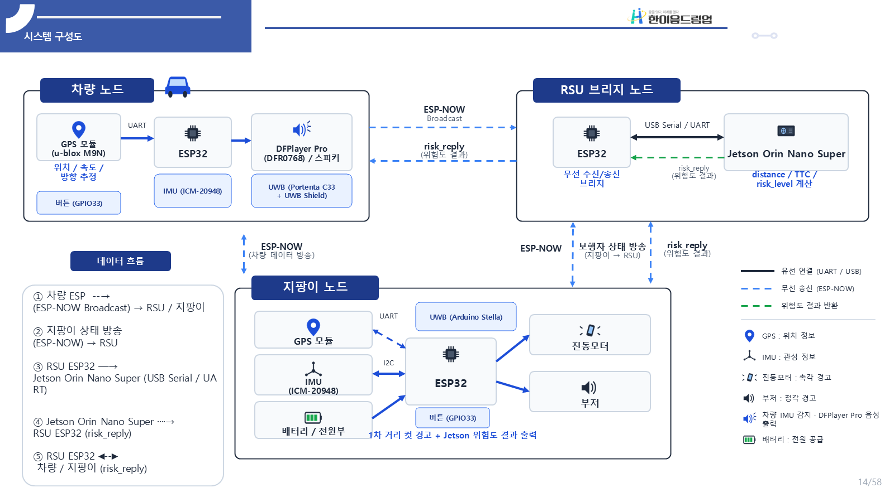
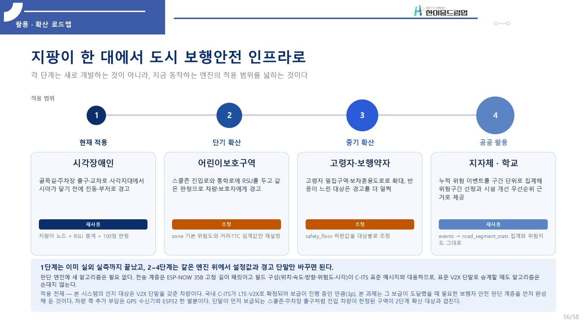
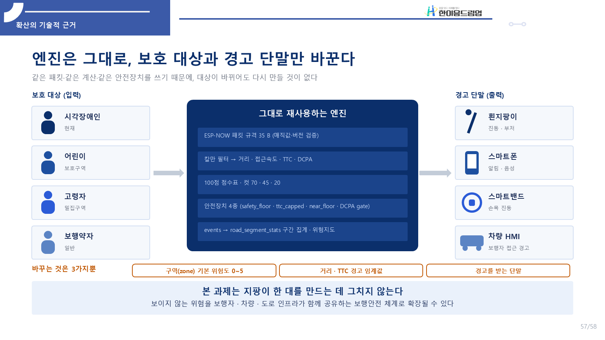
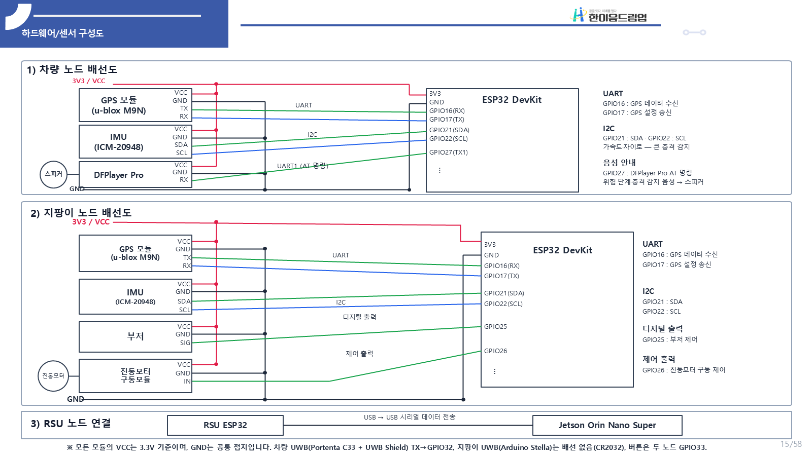
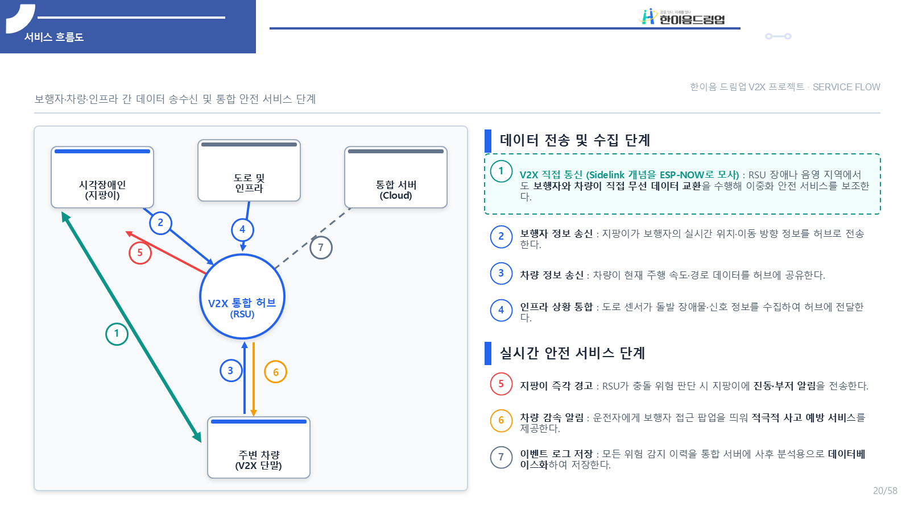
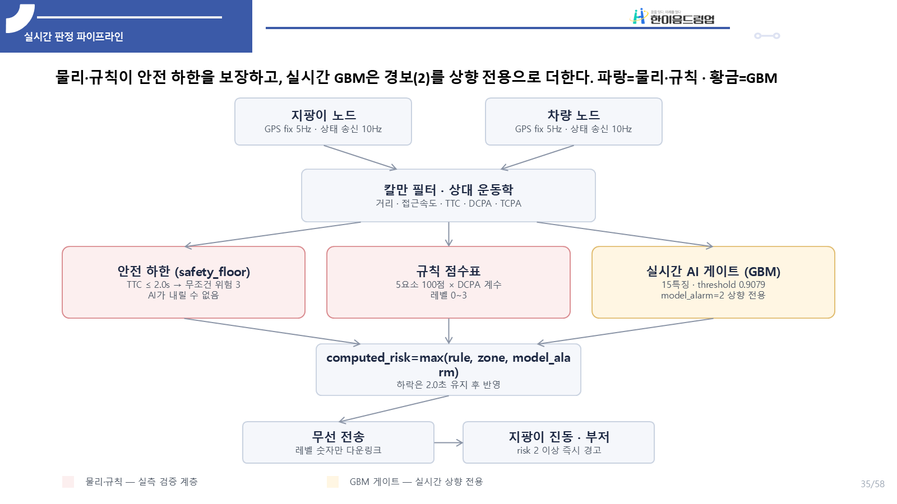
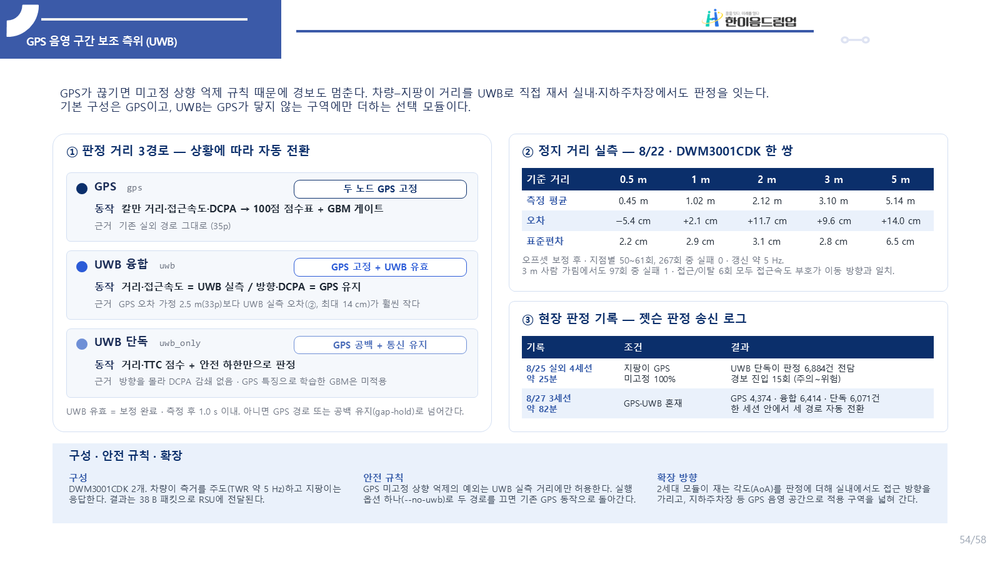
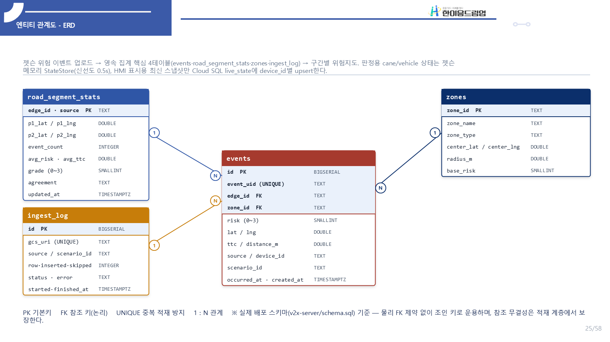

<div align="center">

# 🦯 AI 기반 V2X 협력형 지능형 시각장애인 보행 안전 지팡이 시스템

**2026 한이음 드림업 공모전 · 프로젝트 번호 26_HC019**

보이지 않는 방향에서 다가오는 차량을 통신으로 먼저 알아채고, 지팡이의 진동·부저와 차량의 음성 안내로 알립니다.

      

</div>

---

## 💡1. 프로젝트 개요

**1-1. 프로젝트 소개**
- 프로젝트 명 : AI 기반 V2X 협력형 지능형 시각장애인 보행 안전 지팡이 시스템
- 프로젝트 정의 : 시각장애인이 보행 중 직접 확인하기 어려운 사각지대 차량 접근 위험을 V2X 통신으로 미리 인지하고, 지팡이의 진동·부저 경고와 차량 노드의 음성 안내로 알리는 스마트 지팡이 시스템



**1-2. 개발 배경 및 필요성**
- 도로교통공단 2024년 교통사고 통계에서 전체 교통사고 사망자 2,521명 중 보행 중 사망자가 920명(36.5%)입니다. 그러나 V2X 기술은 아직 차량과 운전자 중심으로 쓰이고, 보행자는 데이터 교환의 대상에서 빠져 있습니다.
- 시각장애인은 흰 지팡이와 점자블록에 의존해 이동하므로 접촉 범위 밖의 상황을 알기 어렵습니다. 건물 모퉁이, 아파트 단지 내 도로, 주차장 진출입로처럼 차량이 갑자기 나타나는 곳에서는 접근 방향과 속도를 미리 확인할 수단이 없습니다. 대한교통학회지(2026)의 TAAS 분석에서도 전국 주차장 교통사고는 2019년 1,308건에서 2023년 1,542건으로 늘었습니다.
- 그래서 차량과 보행자가 위치·속도·방향을 직접 주고받아, 가려진 차량도 접촉 전에 알려 주는 보행자 중심 V2X 안전 시스템이 필요합니다.

**1-3. 프로젝트 특장점**
- **가시선이 필요 없는 통신 기반 인지** : 초음파·카메라처럼 보이는 것만 감지하는 방식과 달리, 차량과 지팡이가 상태를 직접 주고받아 모퉁이 뒤의 차량도 거리·TTC·DCPA로 판정합니다.
- **오경보를 줄인 판정 구조** : 100점 가중 점수에 최근접 접근거리(DCPA) 게이트와 안전장치 4종을 더해, 옆으로 스쳐 지나가는 차량의 오경보를 SUMO 시나리오 기준 58.7%에서 18.1%로 줄였습니다.
- **위험을 낮추지 않는 AI** : 실시간 GBM 게이트는 규칙 판정을 올리기만 하고 내리지 않습니다. 오프라인 Transformer는 3초 뒤 위험을 미리 예측해 홀드아웃 64개 시나리오에서 사전 검출률을 44%에서 91.0%로 높였습니다.
- **GPS가 끊겨도 이어지는 경고** : UWB 측거로 거리를 직접 재어, 지팡이 GPS가 한 번도 잡히지 않은 실외 세션(8/25, 약 25분)에서도 판정 6,884건을 UWB 경로가 맡아 경보를 이어 갔습니다.
- **여러 대의 차량을 동시에** : 차량마다 판정을 따로 유지하는 다중 차량 추적으로, SUMO 동시 접근 재생에서 차량별 경보 구간 1,060개를 모두 유지했습니다.
- **저비용 구조** : 고가의 전용 V2X 단말 대신 ESP32 직접통신과 엣지 판정으로 V2X 협력 안전 서비스의 핵심 흐름을 구현했습니다.

**1-4. 주요 기능**
- 차량·지팡이 상태 송수신 : ESP-NOW 고정 길이 패킷으로 위치·속도·방향·장치 상태를 약 10Hz로 교환 (8/18 실외 시험 수신 9.43~9.62Hz, 손실률 0.49~0.59%)
- RSU 브리지 중계 : 무선 패킷을 모아 USB Serial로 엣지 판단부에 전달, 최대 12개 노드 동시 수용
- 상대 운동 추정 : 칼만 필터로 거리·접근속도·TTC·DCPA를 산출
- 위험도 판정 : 100점 가중 점수 + DCPA 게이트 + 안전장치 4종(safety_floor·ttc_capped·near_floor·dcpa_gate) + 히스테리시스로 위험 단계 0~3 판정
- 실시간 AI 경보 상향 : 15개 특징 GBM 게이트가 규칙 판정을 경고(2)로 상향
- GPS 음영 보조 측위 : UWB 실측 거리로 GPS 거리축을 교체하거나, GPS가 끊기면 UWB 단독으로 판정
- 다중 차량 동시 추적 : 차량 ID마다 판정기를 따로 두고 가장 위험한 단계를 지팡이로 전송
- 경고 출력 : 지팡이 진동·부저, 차량 음성 안내(DFPlayer Pro)
- 누적 위험지도 : 위험 이벤트를 클라우드 서버에 자동 적재하고 도로 구간별로 시각화
- 3초 선행 예측 : Transformer 기반 오프라인 위험 예측을 위험지도에 반영

**1-5. 기대 효과 및 활용 분야**

> 이 프로젝트의 핵심은 **지팡이 한 대에서 끝나지 않는다**는 점입니다. 같은 패킷·같은 계산·같은 안전장치를 그대로 쓰고 **보호 대상과 경고 단말만 바꾸면** 어린이·고령자·작업자·이동체까지 적용 범위가 넓어집니다.

**① 기대 효과**

- **보행자(시각장애인·교통약자)**
  - 건물 모퉁이·주차장 진출입로·차량 사이처럼 **보이지 않는 방향에서 다가오는 차량을 접촉 전에** 알 수 있어, 멈추거나 방향을 바꿀 시간을 확보합니다. 오프라인 검증에서 3초 선행 예측의 선행 경고 시간 중앙값은 4초입니다.
  - 화면을 볼 필요 없이 **진동·부저 패턴으로 위험 단계(주의·경고·위험)를 구분**합니다. 지팡이 쪽에는 스마트폰이나 인터넷 연결이 필요 없습니다.
  - GPS가 약한 **지하·실내 주차장까지 UWB 보조 측위로 경고가 이어져**, 실외 도로에서 주차장 안까지 끊기지 않는 보행 동선을 만듭니다.
- **운전자**
  - 보행자가 가까워지면 **차량 노드가 음성으로 먼저 알려 주고**, 카메라에 잡히지 않는 보행자도 V2X 수신값으로 차량 화면에 표시합니다. 보행자와 운전자가 **같은 위험 정보를 동시에 공유**하는 양방향 안전 구조입니다.
- **지자체·공공기관**
  - 위험 이벤트가 클라우드에 자동으로 쌓이고 **도로 구간 단위 위험지도**가 됩니다. 반복적으로 위험이 생기는 구간, 차량 진출입이 잦은 구간, 점자블록·경보장치가 필요한 구간을 **민원이 아니라 데이터로 골라** 시설 개선 우선순위를 정할 수 있습니다.
- **산업·기술**
  - 판정 엔진은 특정 하드웨어에 묶여 있지 않아 **보행자 안전 앱, 스마트 교차로, 자율주행 보조 시스템**에 모듈로 재사용할 수 있습니다.
  - 패킷 필드 구성(위치·속도·방향·위험도·시각)이 **C-ITS 표준 메시지와 대응**하므로, 표준 V2X 단말로 옮겨 가도 판정 알고리즘은 그대로 씁니다.
  - 차량 쪽은 ESP32와 GPS 수신기를 기본으로 하는 **저비용 구성**입니다. 가장 비싼 엣지 판단부는 교차로·주차장 출입구처럼 **지점마다 1식만 설치해 여러 사람이 함께 쓰는 노변 자원**이고, RSU 1대가 노드 12개를 동시에 받으므로 이용자가 늘수록 1인당 인프라 부담이 줄어듭니다.
- **사회**
  - V2X 기술의 혜택을 운전자 중심에서 **시각장애인·고령자·어린이·전동보장구 이용자**까지 넓혀, 보행 약자를 안전 데이터의 **보호 대상이자 공유 주체**로 포함하는 포용적 스마트시티에 기여합니다.

**② 활용 분야**

| 활용 분야 | 적용 장면 | 그대로 쓰는 것 | 바꾸는 것 |
| --- | --- | --- | --- |
| 🦯 시각장애인 보행 보조 (현재 적용) | 골목길·주차장 출구·교차로 사각지대에서 시야가 닿기 전에 진동·부저 경고 | 지팡이 노드 + RSU 중계 + 100점 판정 | — |
| ♿ 교통약자 보조기기 | 보행보조기·전동휠체어·실버카에 모듈로 부착 | 통신·판정 엔진 | 장착 형태·경고 방식 |
| 🏫 어린이보호구역 | 스쿨존 진입로·통학로에 RSU를 두고 차량과 보호자에게 경고, 아이는 스마트밴드로 손목 진동 | 패킷·판정 엔진 | 구역 기본 위험도, 거리·TTC 임계값, 경고 단말 |
| 👵 고령자 밀집구역·보차혼용도로 | 반응이 느린 대상에게 더 일찍 경고 | 판정 엔진·안전장치 | 안전 하한(safety_floor) 값 |
| 🏢 아파트 단지·학교·병원·대형 상가 | 단지 내 이동 차량, 건물 모퉁이 접근 차량을 보행자와 관리자에게 알림 | 판정 엔진·위험지도 | 구역 설정 |
| 🅿️ 지하·실내 주차장, 주차타워 | 위성 신호가 닿지 않는 곳에서 UWB 측거로 거리·접근속도를 직접 재어 경고 | 같은 점수표·안전장치 | 측위 수단(GPS → UWB) |
| 🏭 물류센터·공장·건설 현장 | 작업자 단말과 지게차·운반차 단말이 상태를 공유해 충돌 위험을 미리 경고 | 거리·접근속도·TTC 계산 | 단말 종류·임계값 |
| 🛴 배달 로봇·전동 이동수단·캠퍼스 이동체 | 이동체와 보행자, 이동체끼리의 충돌 방지 | 판정 엔진 | 임계값 |
| 🗺️ 지자체 보행 위험지도·도시계획 | 반복 경고 구간, 급접근 구간, 보도 단절 구간을 지도에서 찾아 개선 우선순위 결정 | 이벤트 → 구간 집계 → 위험지도 | — |
| 🚦 스마트 교차로·C-ITS 연계 | 표준 V2X 단말·교차로 관제 시스템과 연동 | 판정 알고리즘 | 통신 단말 |
| 📱 위험 판단 API·소프트웨어 모듈 | 보행자 안전 앱, 차량 HMI, 자율주행 보조 시스템에 위험도 계산 제공 | 위험 계산 로직 | 입력 인터페이스 |

**③ 단계별 확산 로드맵 — 지팡이 한 대에서 도시 보행 안전 인프라로**

각 단계는 새로 개발하는 것이 아니라, **지금 동작하는 엔진의 적용 범위를 넓히는 것**입니다. 1단계는 실외 실측까지 마쳤고, 2~4단계는 같은 엔진 위에서 설정값과 경고 단말만 바꾸면 됩니다.

| 단계 | 대상 | 내용 |
| :---: | --- | --- |
| 1. 현재 적용 | 시각장애인 | 사각지대 차량 접근을 진동·부저로 먼저 경고 |
| 2. 단기 확산 | 어린이보호구역 | 스쿨존 진입로·통학로에 RSU 설치, 차량·보호자에게 경고 |
| 3. 중기 확산 | 고령자·보행약자 | 고령자 밀집구역·보차혼용도로로 확대, 반응이 느린 대상은 더 일찍 경고 |
| 4. 공공 활용 | 지자체·학교 | 누적 위험 이벤트를 구간 단위로 집계해 위험 구간 선정과 시설 개선의 근거로 제공 |



**④ 확산의 기술적 근거 — 엔진은 그대로, 보호 대상과 경고 단말만 바꾼다**

- **그대로 재사용하는 것** : ESP-NOW 고정 길이 패킷, 칼만 필터 기반 거리·접근속도·TTC·DCPA 계산, 100점 점수표(컷 70·45·20), 안전장치 4종, 이벤트 → 구간 집계 → 위험지도
- **바꾸는 것은 3가지뿐** : 구역(zone) 기본 위험도, 거리·TTC 경고 임계값, 경고를 받는 단말(흰 지팡이 · 스마트폰 · 스마트밴드 · 차량 HMI)



> 본 과제는 지팡이 한 대를 만드는 데 그치지 않습니다. **보이지 않는 위험을 보행자·차량·도로 인프라가 함께 공유하는 보행 안전 체계**로 확장될 수 있습니다.

**1-6. 기술 스택**
- 하드웨어 : ESP32 DevKitC ×3(차량·지팡이·RSU), GPS u-blox M9N(1세대 NEO-6M), IMU ICM-20948, UWB Portenta C33 + UWB Shield·Arduino Stella(1세대 DWM3001CDK), DFPlayer Pro + 스피커, 진동모터·부저, NVIDIA Jetson Orin Nano Super
- 통신 : ESP-NOW, UWB 양방향 측거(TWR), UART/USB Serial, Wi-Fi
- 펌웨어 : Arduino C/C++
- 엣지·AI : Python, NumPy, 트리 앙상블(GBM), PyTorch(Transformer), ONNX Runtime
- 시뮬레이션 : SUMO, netconvert
- 서버·클라우드 : FastAPI, Google Cloud Run, Cloud SQL(PostgreSQL), Leaflet
- 테스트·관리 : pytest, Git/GitHub

---

## 💡2. 팀원 소개

| **강현준** ([@joon722](https://github.com/joon722)) | **최민서** | **박중선** | **박채린** |
|:---:|:---:|:---:|:---:|
| • 통신·시스템 통합 <br> • ESP-NOW · Jetson 엣지 판정 파이프라인 | • AI·데이터·클라우드 <br> • SUMO 시뮬레이션·라벨링·Transformer 학습 <br> • 위험지도·클라우드 서버(Cloud Run) | • 하드웨어 <br> • 센서·액추에이터 회로, 전원, 기구 | • 웹 <br> • 홈페이지·실시간 차량뷰(`drive.html`) |

---

## 💡3. 시스템 구성도

- **전체 시스템 구성도** — 차량 노드·지팡이 노드·RSU 브리지·Jetson 엣지 판단부


- **H/W 구성도(배선도)** — 차량·지팡이 노드의 센서·출력부 연결



- **서비스 흐름도** — 보행자·차량·인프라 간 데이터 송수신과 안전 서비스 단계



- **실시간 판정 파이프라인** — 물리·규칙이 안전 하한을 보장하고, 실시간 GBM이 경보를 상향 전용으로 더함



- **GPS 음영 구간 보조 측위(UWB)** — 상황에 따라 GPS / UWB 융합 / UWB 단독으로 자동 전환



- **엔티티 관계도** — 위험지도 서버의 영속 집계 4테이블



---

## 💡4. 작품 소개영상

[![[2026 한이음 드림업 공모전] AI 기반 V2X 협력형 지능형 시각장애인 보행 안전 지팡이 시스템](https://img.youtube.com/vi/Auj-7gjxO64/maxresdefault.jpg)](https://www.youtube.com/watch?v=Auj-7gjxO64)

---

## 💡5. 핵심 소스코드

**5-1. 위험도 판정 — 100점 점수표 + DCPA 게이트 + 안전장치** ([`rsu/v2x/03_jetson/step7_risk.py`](rsu/v2x/03_jetson/step7_risk.py))
- 거리·TTC·상대속도·차량속도·장소 위험도를 100점으로 합산한 뒤, 최근접 접근거리(DCPA)가 멀수록 점수를 줄여 스쳐 지나가는 차량의 오경보를 막습니다. TTC가 매우 짧으면 점수와 무관하게 위험(3)으로 고정하고, 코앞에서 다가오면 최소 경고(2)를 보장합니다.

```python
def dcpa_gate(dcpa, near_m=DCPA_NEAR_M, far_m=DCPA_FAR_M, floor=DCPA_FLOOR):
    """Multiplier in [floor, 1] that fades risk out as the miss distance grows.

    dcpa is None when there is no closest approach ahead (receding or static);
    there is nothing to suppress, so the gate is transparent.
    """
    if dcpa is None or dcpa <= near_m:
        return 1.0
    if dcpa >= far_m:
        return floor
    frac = (dcpa - near_m) / (far_m - near_m)
    return 1.0 + frac * (floor - 1.0)
```

```python
    ttc = calculate_ttc(kinematics.distance_m, scored_closing)
    base = calculate_risk_score(
        kinematics.distance_m, scored_closing, vehicle_speed_mps, ttc, zone_base_risk
    )
    gate = dcpa_gate(kinematics.dcpa, near_m, far_m, floor)
    final = round(base * gate, 2)

    # 접근하지 않는 쌍은 calculate_ttc가 9999를 주므로 하한에 걸리지 않는다.
    breached = floor_ttc_s > 0 and ttc <= floor_ttc_s
    capped = not breached and alarm_max_ttc_s > 0 and ttc > alarm_max_ttc_s
    if breached:
        level, reason = 3, "safety_floor"
    elif capped:
        level, reason = 0, "ttc_capped"
    else:
        level, reason = classify_risk_level(final), "table"

    # 근접 거리 하한: 코앞에서 다가오거나 서 있으면(멀어지는 중이 아니면) TTC 상한·
    # 게이트와 무관하게 최소 레벨 보장. 노이즈로 튄 closing 때문에 2 m에서 레벨 0으로
    # 떨어지는 미탐을 막는다. 멀어지는 중이면 걸지 않는다(통신 담당 스펙).
    if (near_floor_m > 0 and kinematics.distance_m <= near_floor_m
            and closing >= 0.0 and NEAR_FLOOR_LEVEL > level):
        level, reason = NEAR_FLOOR_LEVEL, "near_floor"
```

**5-2. AI 경보 게이트 — 올리기만 하고 내리지 않는 구조** ([`rsu/v2x/03_jetson/model_gate.py`](rsu/v2x/03_jetson/model_gate.py))
- 15개 궤적 특징으로 위험 확률을 계산해 문턱을 넘으면 규칙 판정을 경고(2)로 올립니다. 모델이 없거나 추론이 실패하면 규칙 판정 그대로 동작합니다.

```python
    def apply(self, rule_level, now, states):
        """규칙 레벨에 모델 판정을 얹는다.

        states는 (cane_state, veh_state)이며 각각 (동, 북, 동속, 북속)이다.
        step6 KinematicsPipeline.last_states 그대로 넘기면 된다.
        """
        if self.model is None or self.streamer is None or states is None:
            return GateResult(level=rule_level, proba=None, source="table")

        try:
            features = self.streamer.update(now, states[0], states[1])
            proba = self.model.predict_proba(features)
        except Exception as exc:  # noqa: BLE001 - 경보 경로는 어떤 이유로도 멈추면 안 된다
            self.failures += 1
            if self.failures <= 3:
                print(f"[WARN] model_failed error={exc}", file=sys.stderr)
            return GateResult(level=rule_level, proba=None, source="table")

        if proba >= self.model.threshold and rule_level < MODEL_ALARM_LEVEL:
            return GateResult(level=MODEL_ALARM_LEVEL, proba=proba, source="model")
        return GateResult(level=rule_level, proba=proba, source="table")
```

**5-3. GPS 음영 구간 UWB 단독 판정** ([`rsu/v2x/03_jetson/step8_send_risk.py`](rsu/v2x/03_jetson/step8_send_risk.py))
- GPS가 끊겨 판정이 비는 동안, 보정이 끝난 최신 UWB 거리·접근속도만으로 같은 점수표와 안전장치를 적용해 경보를 이어 갑니다.

```python
    def _uwb_only_alarm(self, row):
        now = to_float(row["pc_time"])
        uwb = self._uwb_fresh(now)
        if uwb is None:
            return False
        _, pair_alive, _ = self.pipeline.store.snapshot(now=now)
        if not pair_alive:
            return False
        kin = Kinematics(distance_m=uwb[0], closing_los=uwb[1], closing_diff=None,
                         ttc_simple=None, tcpa=None, dcpa=None,
                         rel_east=0.0, rel_north=uwb[0])
        assessment = assess_risk(kin, vehicle_speed_mps=0.0, **self.gate_params)
        level = assessment.risk_level
        if self.stabilizer is not None:
            level = self.stabilizer.stabilize(level, now, receding=assessment.receding)
        store = self.pipeline.store
        cane = store.latest["cane"]
        decision = self.transmitter.consider(level, cane["gps_valid"], now,
                                             uwb_trusted=True)
```

---

## 📚 학술 활동

개발 결과를 학술대회 논문 원고 3편으로 정리했습니다.
- 「보행자-차량 충돌위험 판단을 위한 저가 GPS 기반 상대운동 추정 성능 분석」
- 「DCPA 기반 오경보 억제와 시계열 학습을 결합한 V2X 보행자 충돌 위험 선행 예측」
- 「학습 기반 판단과 물리 제약을 결합한 GNSS-UWB 근접 경보 공백 감소」

---

## 📁 저장소 구조

| 경로 | 역할 |
| --- | --- |
| [`arduino/`](arduino/) | ESP32 펌웨어 — 차량 / 지팡이 / RSU 브리지, V5 UWB(Portenta C33·Stella) ([코드 맵](arduino/README.md)) |
| [`rsu/v2x/03_jetson/`](rsu/v2x/03_jetson/) | Jetson 엣지 판정 엔진(현장 운용), 트리 모델, 배포 스크립트 |
| [`lux/`](lux/) | 패키지형 판정 엔진과 ONNX 추론 경로, 모듈 단위 테스트 |
| [`AI_Model/`](AI_Model/) | Transformer 학습·ONNX 변환·학습된 모델 |
| [`scripts/`](scripts/) | SUMO 출력 → 구역·위험도·이벤트 라벨링 파이프라인 |
| [`dataset/`](dataset/) | 시나리오별 라벨 데이터셋 |
| [`Simulation/`](Simulation/) | SUMO 시뮬레이션 작업 기록 |
| [`v2x-server/`](v2x-server/) | 위험지도 웹 서버 (FastAPI + PostgreSQL + Leaflet) |
| [`data/`](data/) | 현장 실측 로그 (젯슨 판정 기록·노드 원본 기록) |
| [`docs/`](docs/) | 기술 문서·현장 결과·설치 안내 |

상세 기술 문서 : [README.ko.md](README.ko.md) · [현장 결과](docs/field-results.ko.md) · [AI 운용 상태](docs/current-ai-status.md) · [설치·실행](docs/SETUP.ko.md) · [English](README.en.md)
